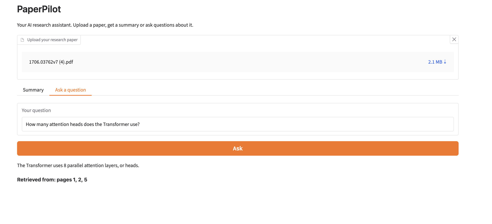

# PaperPilot

PaperPilot is a local AI research assistant. Upload a research paper as a PDF, get a short summary, and ask questions about it. It retrieves relevant passages from the paper to answer questions and is designed to abstain when there is insufficient evidence.

Everything runs on your own machine with [Ollama](https://ollama.com), so papers never leave your computer.



## Features

- **Summary:** a 5-point summary of the whole paper, built section by section so long papers fit.
- **Ask a question:** the model is instructed to answer only from the most relevant passages of the paper, and the app shows the pages that retrieval looked at.
- **Abstains when unsure:** if retrieval finds no close match, or the model finds no answer in the passages, PaperPilot replies "I couldn't find this in the paper."
- **Fast after the first time:** text chunks, embeddings and summaries are cached in SQLite, keyed by the file's content hash, so a renamed copy of the same paper is still found. In a local benchmark, processing a paper took about 11 seconds on the first run, while later loads from the cache were nearly instant.
- **Clear errors:** if Ollama isn't running or a model is missing, the app says what to run.

## How it works

```
PDF → extract text per page (PyMuPDF)
    → split into overlapping chunks (1000 characters, 150 overlap)
    → embed each chunk (nomic-embed-text) → cache in SQLite

Question → embed → cosine similarity → top 4 chunks
         → if the best match is too weak (< 0.60): "I couldn't find this in the paper."
         → otherwise llama3.2:3b answers using only those chunks
```

The "Retrieved from: pages …" line under each answer comes from retrieval, not from the model. In testing, the model sometimes wrote wrong page numbers, so the app doesn't ask it for them.

## Quick start (Docker)

You need [Docker Desktop](https://www.docker.com/products/docker-desktop/). The 3B model needs about 2 GB of disk space and a few GB of free memory.

```bash
git clone https://github.com/nilkayalioglu/paperpilot.git
cd paperpilot
docker compose up -d --build

# Download the models (first time only)
docker exec paperpilot-ollama ollama pull llama3.2:3b
docker exec paperpilot-ollama ollama pull nomic-embed-text
```

Open http://localhost:7860, upload a PDF, and use the **Summary** or **Ask a question** tab.

The first summary of a paper can take a minute or two on a laptop; after that it is cached.

## Running without Docker for the app

Ollama still runs in Docker; the app runs in a Python virtual environment.

```bash
docker compose up -d ollama

# Download the models (first time only)
docker exec paperpilot-ollama ollama pull llama3.2:3b
docker exec paperpilot-ollama ollama pull nomic-embed-text

python -m venv .venv
source .venv/bin/activate
pip install -r requirements.txt
python -m frontend.app
```

To use the smaller, faster model (less accurate, see below), download it first:

```bash
docker exec paperpilot-ollama ollama pull llama3.2:1b
PAPERPILOT_CHAT_MODEL=llama3.2:1b python -m frontend.app
```

## Tests

```bash
pip install -r requirements-dev.txt
python -m pytest
```

50 tests cover PDF extraction, chunking, retrieval, the cache and the evaluation helpers. They don't need Ollama. Use `python -m pytest`; plain `pytest` can't find the `backend` package.

## Evaluation

`eval/questions.json` has 15 questions about *Attention Is All You Need* ([arXiv:1706.03762](https://arxiv.org/abs/1706.03762)): 10 with answers in the paper and 5 whose answers are not in the paper. Download the paper to `papers/attention.pdf`, then run:

```bash
python -m eval.run_eval                                    # default model, 3 runs
PAPERPILOT_CHAT_MODEL=llama3.2:1b python -m eval.run_eval  # compare with 1b
python -m eval.run_eval path/to/paper.pdf path/to/questions.json 5   # any paper, 5 runs
```

Results (3 runs each):

| | llama3.2:3b | llama3.2:1b |
|---|---|---|
| Retrieval: right page in top 4 | 10/10 | 10/10 |
| Correct answers (answer in the paper) | 29/30 | 29/30 |
| Exact "I couldn't find this in the paper" (automatic check) | 15/15 | 0/15 |
| Refused in any wording (read by hand) | 15/15 | 5/15 |

Retrieval is the same for both models, and both answer the answerable questions equally well, so the difference is on questions the paper can't answer. The 1B model invented an answer in 10 of 15 cases, for example "GPT-3 has approximately 110 million parameters" or a BLEU score for English-to-Spanish translation, which the paper never reports. The 3B model refused every time. This is why 3B is the default.

The 3B model's one miss was a refusal: in one run it said the excerpts didn't contain d_model, although they did.

**How answers are scored:** a simple automatic check that looks for the expected value in the reply as a whole number or word, after removing page citations. It does not understand meaning, so replies were also read by hand. That's how I found that 1B sometimes refuses in its own words ("not explicitly stated in the excerpts"), which the automatic check counts as a miss.
## Limitations

- The evaluation uses one paper and 15 questions. 3B did not invent answers to these 5 unanswerable questions in 3 runs, but that does not show it never hallucinates.
- Broad or general questions may sometimes be rejected even when relevant information exists in the paper.
- "Retrieved from" pages show where retrieval looked, not proof that the answer is correct.
- Scanned PDFs (images without a text layer) are not supported.
- Answers vary slightly between runs because the model samples its output.

## Project structure

```
backend/    PDF extraction, chunking, retrieval, answering, summarising, SQLite cache
frontend/   Gradio interface (Summary and Ask tabs)
eval/       evaluation questions and script
tests/      pytest tests
docs/       screenshots
DEVLOG.md   day-by-day development notes, including what was tried and what changed
AI_NOTES.md  how AI tools were used during development, and what I tested and changed
```

## Tech

Python, Gradio, Ollama (llama3.2:3b, nomic-embed-text), PyMuPDF, NumPy, SQLite, Docker, pytest, GitHub Actions, CodeRabbit.